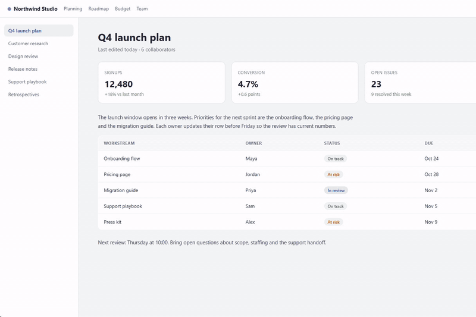
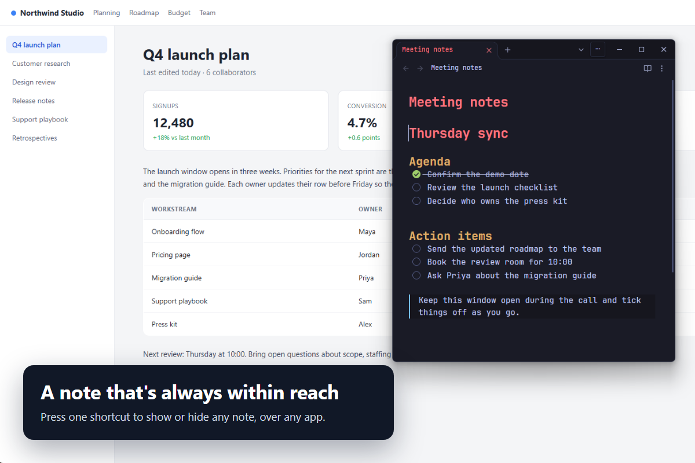
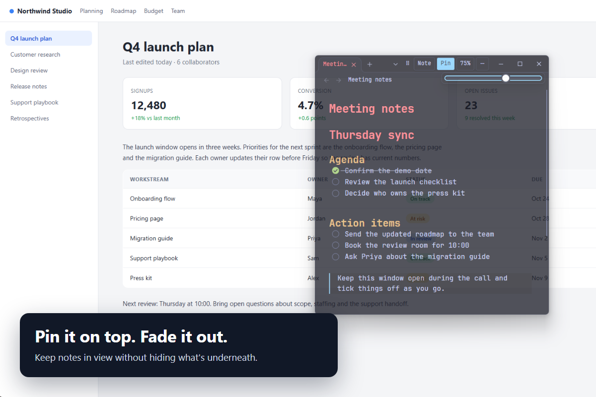
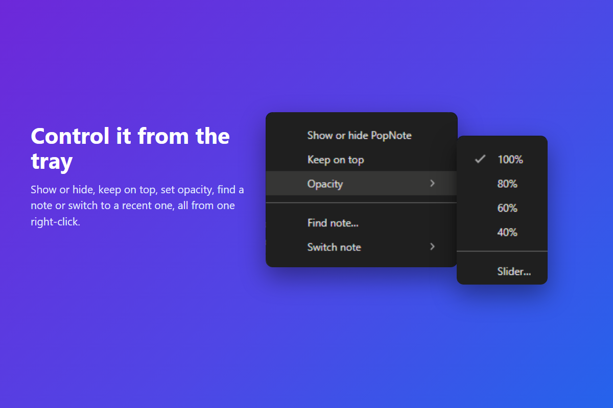
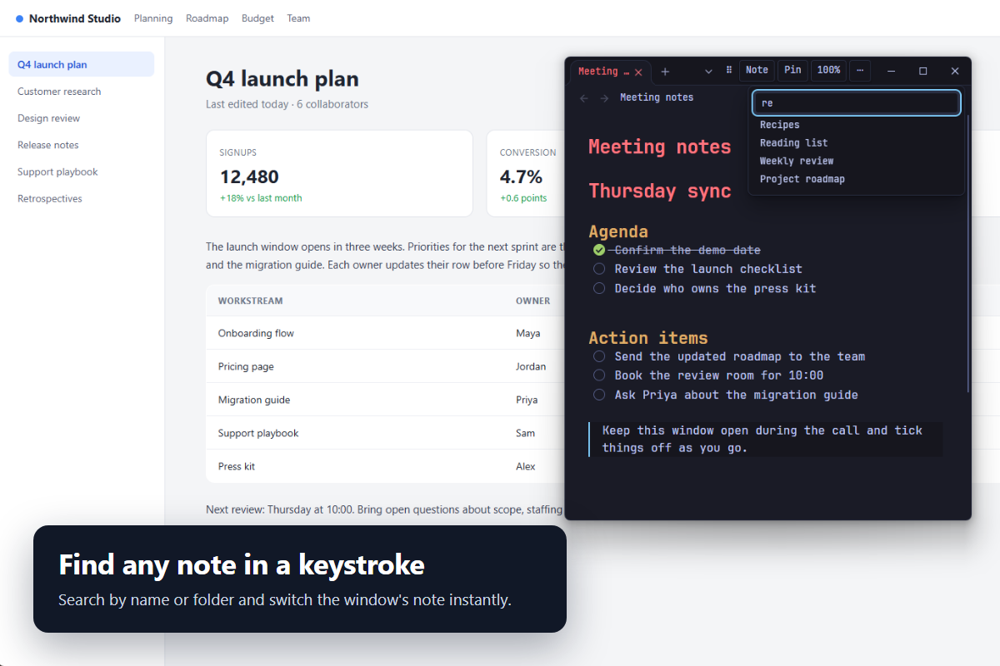
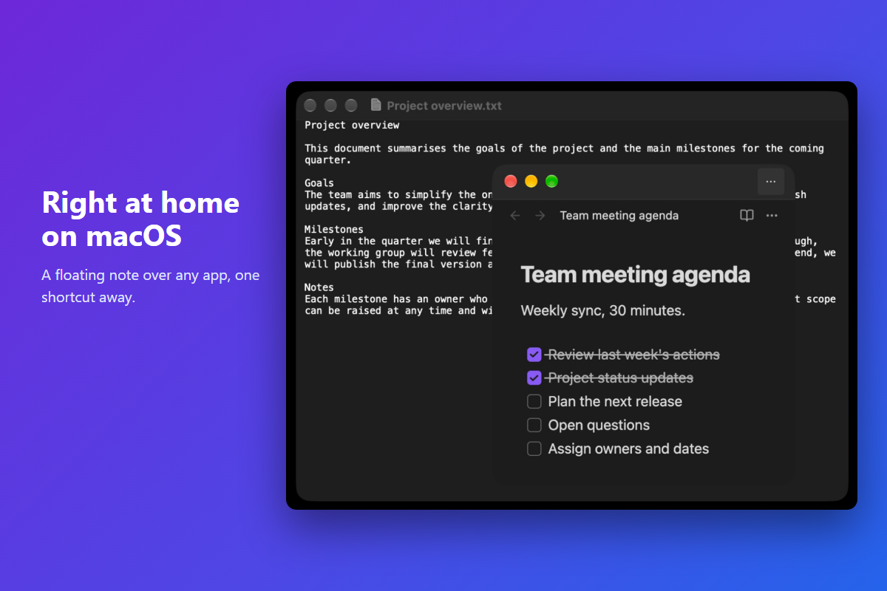
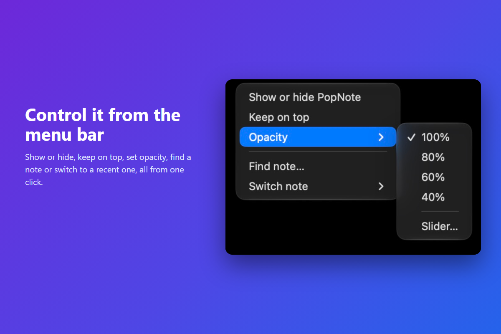

# PopNote

**A floating window for your notes. Press one shortcut, and your note appears over any app.**

PopNote shows an Obsidian note in its own small desktop window. Keep it on top while you work in other apps, fade it
out when it is in the way, and hide it again with the same key. It uses Obsidian's own pop-out window, so it looks like
your theme and fonts. Desktop only.

## Why PopNote

- **Notes during a call.** Keep the agenda and action items in view while you talk.
- **A checklist beside your work.** Tick things off while you code, write or browse.
- **Reference text next to another app.** Copy from a note without switching windows.

## Install

From Obsidian: **Settings → Community plugins → Browse**, search for **PopNote**, then **Install** and **Enable**.

To install by hand, download `main.js`, `manifest.json` and `styles.css` from the
[latest release](https://github.com/iijarrett/popnote/releases/latest), copy them into `.obsidian/plugins/popnote/` in your
vault, restart Obsidian and enable **PopNote** under **Community plugins**.

Requires Obsidian 1.5.12 or newer on desktop.

## Quick start

1. Open the note you want to keep handy.
2. Press **Ctrl+Alt+P** (Windows, Linux) or **Command+Option+P** (macOS). PopNote opens that note in a floating window.
3. Press the shortcut again to hide it. It comes back in the same place, at the same size.

To show a different note, open **⋯** in the window's tab strip, choose **Note**, type part of a name or folder and press
Enter. You can also run **PopNote: Use current note** to switch to the note you are looking at.

## Features

- **One shortcut to show or hide.** Change it in the settings. Pressing it while PopNote is focused hides it.
- **Pin on top.** Keep the window above your other apps.
- **Opacity slider.** Fade the window so you can see what is underneath.
- **Find any note.** A search box in the window picks a note by name or folder.
- **Remembers everything.** The note, size, position, pin and opacity are saved.
- **Tray or menu-bar icon (optional).** A click shows or hides PopNote. A right-click opens a menu: show or hide,
  **Keep on top**, **Opacity** (presets or **Slider…**), **Find note…** and **Switch note** (your five most recent).
- **Follows you across desktops (Windows).** If PopNote was left on another virtual desktop, the shortcut or tray icon brings it to the one you are on.
- **Fits any theme.** It uses your theme's colors and fonts, with nothing to set up.
- **Works at small sizes.** The window can shrink to 340 × 160 and keeps a place to grab it.

| | |
|---|---|
|  |  |
|  |  |

On macOS:

| | |
|---|---|
|  |  |

## Settings

- **Global shortcut.** Write it without spaces, for example `Ctrl+Alt+P`. Use `Super` for the Windows key (`Super+Q`) and
  `Command` on a Mac. Spellings such as `Win + Q` can fail. A refused shortcut keeps the previous one.
- **Show on all desktops.** macOS Spaces and similar. Applies the next time PopNote opens.
- **Tray icon.** Off by default. Windows may place a new icon behind the **^** in the taskbar. Drag it out to keep it
  visible. Some Linux desktops have no tray.

Commands you can give hotkeys in **Settings → Hotkeys**: **PopNote: Toggle window**, **PopNote: Use current note** and
**PopNote: Show controls**.

## Platforms

| Platform | Status |
|---|---|
| Windows 11 | Tested the most: Obsidian 1.15.1, plus runs on 1.5.12, 1.7.7, 1.8.10 and 1.10.6. |
| macOS (Apple Silicon) | Tested on Obsidian 1.15.0 with the real shortcut, menu-bar icon and window input. Intel Macs are not confirmed. With a full-screen app in front, the shortcut switches to PopNote's own desktop instead of floating over that app. |
| Linux | Checked under WSLg only. Window opacity is not applied there, so that control is disabled. Tray support depends on the desktop. |
| Mobile | Not supported. PopNote does nothing on mobile. |

On Windows, if you leave PopNote on one virtual desktop and switch to another, the shortcut or tray icon brings it to the desktop you are on. To keep one window on every desktop instead, press Win+Tab, right-click the PopNote window and choose **Show this window on all desktops**. See [TESTING.md](TESTING.md) for dated test results and what is still unconfirmed.

## Things to know

- **It uses features Obsidian does not document.** The shortcut, tray icon, pin and opacity rely on Electron access
  that Obsidian does not officially expose. If one is unavailable, PopNote turns just that feature off with a notice and
  keeps working. An Obsidian update could change this.
- **Restart safety.** PopNote keeps its window out of Obsidian's saved layout so it does not come back as a stray window
  after a restart. If that protection is unavailable, PopNote tells you.

## Privacy

PopNote makes no network requests and collects nothing. Settings are saved in the vault's plugin data (`data.json`).

## Support

Found a problem or have an idea? [Open an issue](https://github.com/iijarrett/popnote/issues). Please say which system
and Obsidian version you use.

## Build

`npm ci --ignore-scripts`, then `npm run build` (type-check and bundle to `main.js`). `node --test tests/*.test.mjs`
runs the checks. `tests/installed-workspace.test.mjs` reads an installed Obsidian archive (set
`POPNOTE_OBSIDIAN_ASAR` if it is not at the Windows default); after an Obsidian update its name table needs re-mapping.
Build-time dependencies are `obsidian@1.14.4`, `typescript@5.8.3` and `esbuild@0.25.5`; nothing is shipped at runtime.
Test in a disposable vault only. `data.json`, build output and personal planning files are excluded from Git.

## License

PopNote is released under the [MIT License](LICENSE).

## Technique credits

The unique-title native-window lookup follows the approach credited to **Desktop Sticky Notes** (MIT). The remote
entry-point fallback follows the approach credited to **Quick Tray** (MIT). The implementations here were written for
this project; their upstream sources were not fetched or copied.
